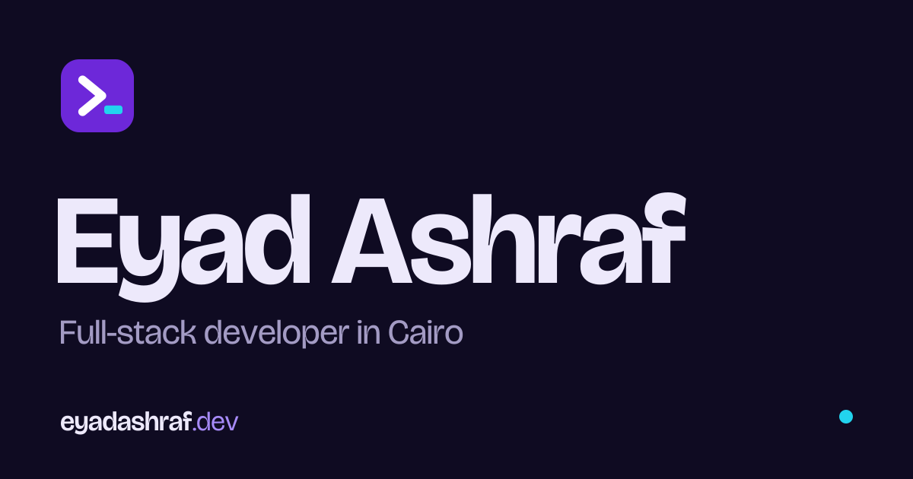

# Eyad Ashraf — Portfolio

[](https://eyadashraf.dev/)
[](https://react.dev/)
[](https://vitejs.dev/)

A fast, polished portfolio for **Eyad Ashraf**, a full-stack web developer based in Cairo, Egypt. The site showcases selected work, services, collaborations, recommendation letters, and a direct contact flow.

<p align="center">
  
</p>

## Highlights

- Responsive, accessible portfolio experience
- Animated hero and scroll-based interactions
- Selected-project showcase with media previews
- Professional background, skills, and services sections
- Collaboration and recommendation sections
- Custom light and dark themes
- Contact form and direct email links
- Copy-to-clipboard email interaction
- Back-to-top and scroll-progress controls
- SEO metadata, social preview, sitemap, and structured data
- Static pre-rendering for production builds

## Built With

| Technology | Purpose |
| --- | --- |
| React 19 | User interface and component architecture |
| Vite 8 | Development server and optimized builds |
| JavaScript / JSX | Application logic and components |
| CSS | Responsive layout, themes, and motion |
| React Hooks | State, effects, pointer, scrolling, and form behavior |
| Node.js scripts | Production build pre-rendering |

## Project Structure

```text
eyad-ashraf-portfolio/
├── public/
│   ├── letters/                # Recommendation PDFs
│   ├── videos/                 # Public project and showcase media
│   └── ...                     # Icons, manifest, SEO, and social assets
├── scripts/
│   └── prerender.js            # Pre-renders the production app
├── src/
│   ├── assets/                 # Images, logos, and project previews
│   ├── components/
│   │   ├── layout/             # Header and footer
│   │   └── ui/                 # Reusable interface components
│   ├── config/                 # Portfolio-wide configuration
│   ├── data/                   # Projects, services, letters, and content
│   ├── hooks/                  # Reusable React hooks
│   ├── lib/                    # Shared utilities
│   ├── sections/               # Page sections
│   ├── services/               # Contact and external integrations
│   ├── styles/                 # Global theme and base styles
│   ├── App.jsx                 # Main application composition
│   ├── entry-server.jsx        # Server entry for pre-rendering
│   └── main.jsx                # Browser entry
├── index.html
├── vite.config.js
└── package.json
```

## Getting Started

### Requirements

- Node.js 18 or newer
- npm

### Installation

```bash
git clone https://github.com/eyadwebdeveloper/portfolio.git
cd portfolio
npm install
```

### Development

```bash
npm run dev
```

Open the local URL shown by Vite in your browser.

### Production Build

```bash
npm run build
```

This creates both the client bundle and server build, then runs the pre-rendering script.

### Preview Production Output

```bash
npm run preview
```

## Customization

Most portfolio content can be updated in the configuration and data files:

- **Site identity and social links:** `src/config/siteConfig.js`
- **Projects:** `src/data/projects.js`
- **Services:** `src/data/services.js`
- **Recommendations:** `src/data/letters.js`
- **Organizations:** `src/data/organizations.js`
- **Skills:** `src/data/skillGroups.js`
- **Contact subjects:** `src/data/contactSubjects.js`
- **Global colors and themes:** `src/styles/theme.css`
- **Global styles and resets:** `src/styles/base.css`

Images and other public assets belong in `src/assets/images/` or `public/`, depending on whether they are imported by components or referenced by public URL.

## Deployment

The project can be deployed to any static host that supports a Vite build, including:

- Vercel (It's deployed by vercel)
- Netlify
- Cloudflare Pages
- GitHub Pages
- Traditional web hosting


## Contact

- **Website:** https://eyadashraf.dev/
- **Email:** projects@eyadashraf.dev
- **GitHub:** https://github.com/eyadwebdeveloper
- **LinkedIn:** https://www.linkedin.com/in/eyadwebdeveloper

## License

This is a personal portfolio project. Source content, design, images, and identity assets belong to Eyad Ashraf.
